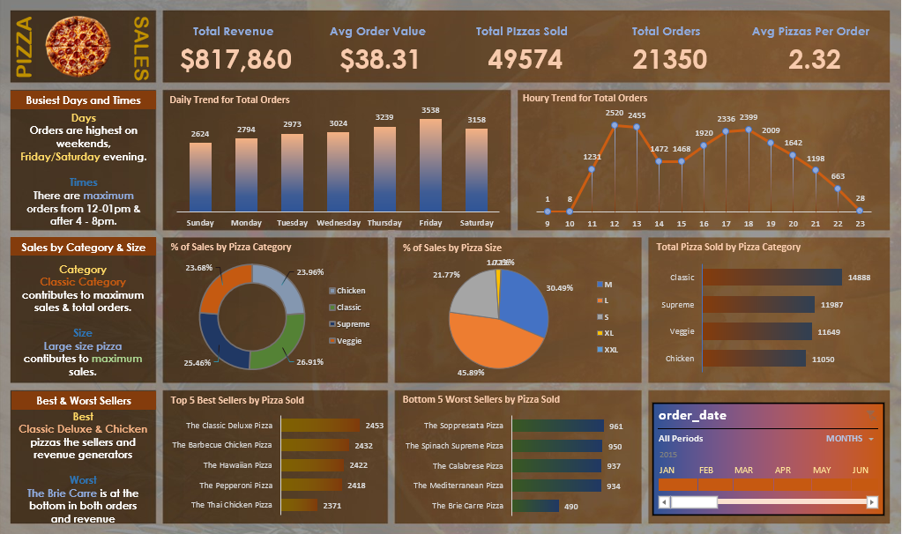

# Pizza Sales Dashboard

## About the Project

This project analyzes pizza sales data using MySQL and Microsoft Excel. It explores sales performance, customer ordering patterns, and product trends through SQL queries and an interactive Excel dashboard.

Built while following a YouTube tutorial, then analyzed and documented by me.

## Dataset

- Records: 48,620 rows
- Columns: 15
- Data: Pre-cleaned dataset

## Tools Used

- **MySQL:** SQL queries and data analysis
- **Microsoft Excel:** Data analysis and interactive dashboard

## Business Questions Answered

- What are the total revenue, orders, and average order value?
- Which days and hours have the highest order activity?
- Which pizza categories and sizes contribute most to sales?
- What are the top 5 and bottom 5 best-selling pizzas?

## Key Insights

- Total Revenue: $817,860
- Total Orders: 21,350
- Total Pizzas Sold: 49,574
- Average Order Value: $38.31
- Average Pizzas Per Order: 2.32
- Friday and Saturday evenings have the highest order activity.

## Skills Demonstrated

- **SQL:** Aggregation, GROUP BY, DISTINCT counts, filtering and sorting.
- **Excel:** Pivot Tables, charts, dashboard design and slicers.
- **Data Analysis:** Sales analysis, KPI reporting and business insights.
- 
## Repository Files

- [pizza_sales_queries.sql](pizza_sales_queries.sql) – SQL queries used for analysis.
- [dashboard_overview.png](dashboard_overview.png) – Excel dashboard preview.

## Dashboard Overview
  
